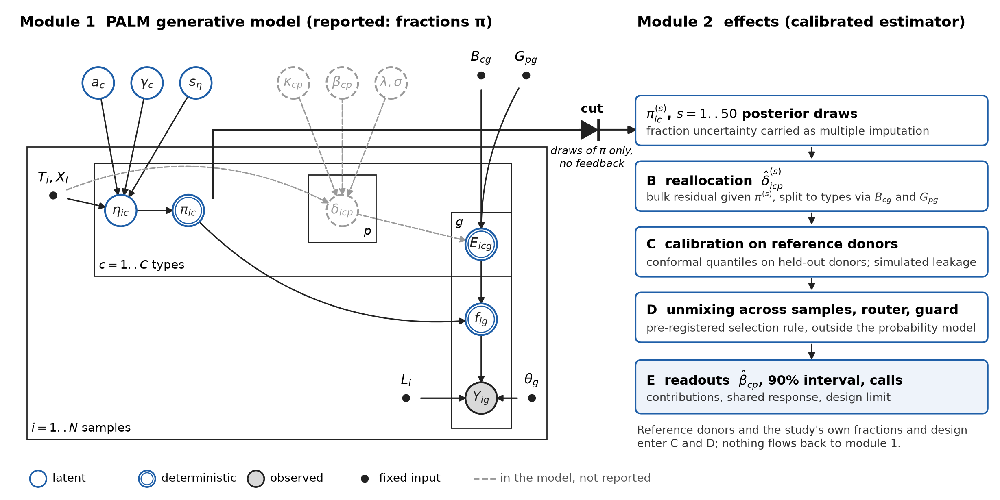

# PALM as a modular model with a cut (R1, Paper 1 Methods)

*Status 2026-11-13: draft text for the Paper 1 Methods and supplement. No method change: this describes
freeze v2 (and the v5 candidate) as they are. Plan context: `palm_uni_plan.md` §2. Numbers come from
development and held-out runs already done; sources are given per row. Citations written from memory:
verify before submission.*

## 1. What the framing says

program2cell has two modules:

| Module | Estimates | How | Uses from the other module |
|---|---|---|---|
| **1. Composition (PALM)** | fractions π_ic, with posterior draws | generative model of the bulk (`model_dag.md` §2), two-stage fit, NUTS | nothing |
| **2. Effects** | activity δ_icp, effects β_cp, calls, contributions | reallocation → calibration on reference donors → effects router (stages B–D) | draws of π only |

The **cut** is the arrow that is *not* there: nothing in module 2 (the activity and effect estimates, their
misfit, the calibration data) flows back into π. Module 1's own δ and β exist inside the model but are not
reported and do not enter module 2.

Formally, the full Bayesian answer would be the joint posterior

    p(π, δ, β | Y)  ∝  p(Y | π, δ) p(δ | β) p(π) p(β),

in which the effect part and the composition part inform each other. The cut replaces it with

    π^(s) ~ p_1(π | Y)                      (module 1 posterior, s = 1..S, S = 50)
    β̂^(s) = h(Y, π^(s); reference donors)   (module 2, a calibrated estimator)

and reports β with an interval that combines the spread of β̂^(s) over the fraction draws with module 2's
calibrated error (conformal quantiles, simulated leakage error, bootstrap). This is a cut distribution in the
sense of Plummer (2015) with a non-Bayesian second module: module 2 is a calibrated estimator evaluated at
each posterior draw of π, so fraction uncertainty is propagated as in multiple imputation.

## 2. Draft Methods text

> **Model structure.** program2cell separates estimation into two modules linked by a one-way cut (Plummer
> 2015; Jacob et al. 2017). The composition module is PALM, a hierarchical generative model of bulk counts as
> a negative-binomial mixture of reference profiles (Methods, *PALM model*); it returns posterior draws of
> each sample's cell-type read fractions. The effect module takes these draws as input and estimates
> cell-type program activity and group effects by reallocation, calibration on held-out reference donors,
> and cross-sample unmixing (Methods, *Effects*). Information flows from the first module to the second only:
> the effect module's estimates do not update the fractions, and the composition model's own activity
> parameters are not reported.
>
> **Why a cut.** A joint posterior is only as reliable as its weakest component. The effect part of PALM
> rests on assumptions that are known to fail: a fixed reference profile per cell type, program footprints
> shared by all cell types, no response outside the known programs, and fixed RNA content per cell. Under
> such misspecification a posterior still concentrates as data accumulate, but on a biased value
> (Kleijn & van der Vaart 2012), and joint inference lets the misspecified component distort the others
> (Jacob et al. 2017). On 8 development datasets with a known answer, the joint model's own effect
> estimates correlated less with the truth than the cut estimator (r 0.50 vs 0.86), its 90% intervals
> covered half of the true effects (per dataset 0.37–0.82), and it called 28% of pairs whose true effect was
> null (cut estimator: 3%; Supplementary Table X). We therefore use the joint model only where it
> performed well, for the composition, and estimate effects with a module whose error is measured on data
> with a known answer rather than assumed.
>
> **What the cut does not provide.** Cutting alone does not make the effect intervals honest: reallocation
> on posterior fractions without calibration covered the truth in 8% of cases and called 89% of null pairs
> (Supplementary Table X). Coverage comes from the effect module's calibration: conformal quantiles from reference donors
> not used to build the reference, and leakage errors simulated with the study's own fractions and design.
> The choice between the unmixed and the calibrated estimate (the *router*) and the consistency check
> between them (the *guard*) are a selection rule, not part of a probability model. Both were fixed before
> any held-out data were analysed (method freeze v2) and evaluated once on held-out splits, where coverage
> was 0.93–1.00 and false calls on unchanged pairs at most 0.08 on all 13 datasets.

## 2b. Model diagram and specification (Figure, cell2location style)

Figure: `docs/figures/methods/palm_plate.{png,pdf}`, made by `scripts/plate_diagram.py`. Notation follows
the cell2location plate diagram (Kleshchevnikov et al. 2022, Fig. 1b): circles latent, shaded observed,
double circles deterministic, dots fixed inputs; grey dashed nodes exist in the model but are not reported.
The valve on the arrow from π to module 2 is the cut (Plummer 2015).

**Module 1 (PALM), written as cell2location writes its model.** Counts of gene g in sample i:

    Y_ig ~ NB(μ_ig, θ_g),          μ_ig = L_i · Σ_c π_ic E_icg
    E_icg = softmax_g( log B_cg + Σ_p δ_icp G_pg )                  type c's profile in sample i
    π_i   = softmax_c(η_i),         η_ic = a_c + γ_c T_i + Σ_k X_ik A_kc + s_η ε_ic
    δ_icp = κ_cp + β_cp T_i + λ_p u_ip + σ_d z_icp + Σ_k X_ik D_kcp  (fitted, not reported)

with B_cg fixed from the single-cell reference (atlas pseudobulk shares), G_pg fixed program weights, L_i
library size, θ_g fixed moment estimates of dispersion, and priors as in `model_dag.md` §2. Fit: two-stage
(Laplace summary per sample, NUTS on population parameters). Reported: 50 posterior draws of π.

**Module 2** takes those draws and returns β̂_cp with calibrated intervals (Methods, *Effects*).

**Correspondence with cell2location** (for the Methods text and for reviewers who know it):

| cell2location | program2cell module 1 | Comment |
|---|---|---|
| reference signatures g_fg, NB regression on scRNA, then fixed | B_cg from atlas pseudobulk, fixed | both are cuts: the bulk/spatial data do not update the reference |
| abundance w_sf (cells), prior in cells per location | read fractions π_ic, logistic-normal prior with a design regression | ours models the study design (T, X); c2l models co-location |
| m_g gene-wise technology sensitivity | m_g (`use_m`; off in freeze v2) | same term |
| y_s per-location detection | L_i | redundant here: f is normalised, so a per-sample scale is the library size |
| s_eg additive background per experiment | none | candidate for PALM-uni (`palm_uni_plan.md` §3.4) |
| — | δ_icp, β_cp, G_pg | c2l has no covariate or program layer |
| ADVI (mean-field) | two-stage Laplace + NUTS; effects by a calibrated module | c2l reports no interval calibration; ours is checked on known answers |

Draft sentence: *"Module 1 has the structure of reference-based probabilistic deconvolution models such as
cell2location (Kleshchevnikov et al. 2022): a negative-binomial likelihood with reference signatures fixed
from single-cell data, which is itself a cut between the reference and the mixture data."*

## 3. Supplementary table: joint posterior vs cut

### 3.1 Head to head (run 2026-11-13, development splits 0–2)

Same datasets, splits, truth, fractions and scorer for all three estimators
(`scripts/experiments/cut_vs_joint.py`; per-run rows in `benchmarks/dev/cut_vs_joint.csv`, freeze v2 runs in
`benchmarks/dev/causal_loop/<ds>__s<k>__auto_v2.json`). 8 datasets × 3 splits: Kang, Zhang, McFarland
idasanutlin and trametinib (each with and without a composition shift), PBMC, OneK1K.
- **joint**: the joint PALM model's own β (NB fit, saved draws `<ds>/s<k>__joint_nb.npz`), median and 90%
  equal-tailed interval.
- **cut, no calibration**: treated-minus-control contrast of reallocation on each posterior draw of π.
- **cut + calibration + unmixing**: freeze v2 (`estimator="auto"`), on the same π draws.
A call is an interval excluding 0 (freeze v2: its own calls, same rule). Null pair: |true β| < 0.05.
Wrong call: a call on a null pair or with the wrong sign.

**All datasets (mean over dataset × split, 24 runs):**

| Estimator | Coverage (target 0.90) | r with truth | Mean width | Calls per run | Wrong calls per run | Null pairs called | True effects called | Responder AUROC |
|---|---|---|---|---|---|---|---|---|
| Joint posterior | 0.50 | 0.50 | 0.086 | 14.7 | 6.6 | 0.28 | 0.91 | 0.80 |
| Cut, no calibration | 0.08 | 0.77 | 0.006 | 32.3 | 20.0 | 0.89 | 0.98 | 1.00 |
| **Cut + calibration + unmixing (freeze v2)** | **0.97** | **0.86** | 0.220 | 5.5 | **0.6** | **0.03** | 0.88 | 1.00 |

**Per dataset (coverage / r / null pairs called):**

| Dataset | Joint posterior | Cut, no calibration | Freeze v2 |
|---|---|---|---|
| Kang (IFN-β) | 0.46 / 0.63 / 0.16 | 0.08 / 0.98 / 0.79 | 1.00 / 0.90 / 0.00 |
| Zhang (no known answer) | 0.82 / 0.43 / 0.02 | 0.24 / 0.74 / 0.83 | 1.00 / 0.80 / 0.00 |
| McFarland idasanutlin | 0.41 / 0.58 / 0.57 | 0.01 / 0.77 / 0.97 | 0.91 / 0.91 / 0.05 |
| McFarland trametinib | 0.44 / 0.53 / 0.42 | 0.00 / 0.87 / 0.97 | 0.96 / 0.92 / 0.05 |
| McFarland idasanutlin, shift | 0.37 / 0.60 / 0.61 | 0.00 / 0.76 / 0.86 | 0.95 / 0.89 / 0.03 |
| McFarland trametinib, shift | 0.37 / 0.59 / 0.43 | 0.01 / 0.89 / 0.92 | 0.96 / 0.94 / 0.06 |
| PBMC | 0.57 / 0.44 / 0.00 | 0.11 / 0.37 / 0.86 | 0.99 / 0.71 / 0.00 |
| OneK1K | 0.54 / 0.21 / 0.01 | 0.23 / 0.74 / 0.88 | 1.00 / 0.77 / 0.02 |

Reading:
1. **The joint posterior is the misspecified module.** Its effects track the truth worst (r 0.50), its 90%
   intervals cover half the truth, and on the cell lines it calls 42–61% of null pairs. On PBMC and OneK1K it
   makes almost no calls, but still covers only 0.54–0.57: narrow intervals around the wrong value, which is
   the misspecification signature.
2. **Cutting fixes the point estimates, not the intervals.** Reallocation on the same posterior π tracks the
   truth better (r 0.77) but its intervals carry only fraction uncertainty: coverage 0.08, 89% of null pairs
   called.
3. **Calibration and unmixing make the intervals honest** (coverage 0.97, 3% of null pairs called) and give
   the best point estimates (r 0.86). The price is power: 0.88 of clear true effects called vs 0.91–0.98, and
   Kang's shared interferon response is called in half the types (0.50; the shared-response readout covers it).

Caveats:
- The joint fits are the October/late-October NB fits (saved 2026-10-26 to 10-28) with the model settings of
  that time; they were not refitted. Their β is on the same δ scale as the truth (program weights scaled by
  median |w| since the first commit).
- The PBMC and OneK1K reallocation draws in those files predate the `estimate_delta` convergence fix
  (2026-10-28, `method_spec.md`); this affects only the "cut, no calibration" row there.
- The coverage of the joint β here (0.37–0.82) is lower than the 0.79–0.84 reported for PBMC in
  `benchmarking.md` §7 (2026-10-27). The truth has been recomputed since (Kang truth fix and `estimate_delta`
  fix, 2026-10-28); the head-to-head numbers above use the current truth and supersede the earlier ones.

### 3.2 Earlier snapshots (descriptive, kept for the record)

The rows come from different development runs (datasets, splits and dates differ), so they show the
direction of each step, not a head-to-head test.

| Estimator | What it is | Activity ρ (δ truth) | Effect interval coverage (target 0.90) | Calls | Source |
|---|---|---|---|---|---|
| Joint posterior (October model) | PALM's own δ and β | PBMC 0.52–0.60; OneK1K 0.43–0.49 | PBMC 0.79–0.84; OneK1K 0.73 (joint quasi+sw) | OneK1K: 0 | `benchmarking.md` §7 |
| Cut, no calibration | reallocation on PALM's posterior π | PBMC 0.85; OneK1K 0.74 | 0.18–0.35 (PBMC joint NB, splits 0–2: 0.21) | PBMC split 0: 19 of 20 wrong | `benchmarking.md` §5, §5c, §7 |
| Cut + calibration (Oct 27) | + ridge calibration, conformal activity intervals | PBMC 0.83–0.86 | 0.77 | false sign rate 0.07–0.09 | `benchmarking.md` §5c |
| Cut + calibration + unmixing (freeze v2), held-out | the frozen method | — | 0.93–1.00 on all 13 datasets | false calls on unchanged pairs ≤ 0.08; real COMBAT bulk 0–0.006 | `heldout_v2_results.md` |

Reading, in order:
1. Using the joint model's activity and effects is worse than reallocation on its fractions, and its
   intervals undercover: the effect part of the joint model is the misspecified module.
2. Cutting fixes the point estimates but not the intervals: without calibration they are far too narrow.
3. Calibration and unmixing make the intervals honest; that held on unseen splits.

## 4. Questions a reviewer may ask

**"Why not a single model?"** One was built first and is the composition module now. Its effect part was
misspecified in ways the data showed (table above). The cut is the standard remedy for a known-misspecified
module (Plummer 2015; Jacob et al. 2017; Carmona & Nicholls 2020). A model that adds the missing error
sources and calibrates its posterior is future work (`palm_uni_plan.md`, R2).

**"Is the uncertainty in π propagated?"** Yes. Module 2 runs on each of 50 posterior draws of π, and the
spread across draws enters every effect interval. What the cut drops is feedback from module 2 to π, not the
uncertainty of π.

**"Are the router and guard ad hoc?"** They are a selection rule with no probabilistic derivation. They were
fixed before held-out analysis, under a pre-registered decision rule, and evaluated once (splits 20–29).
Coverage held on both routes separately (blood: calibrated 1.00, unmixed 0.97; cell lines 0.96 each;
`heldout_v2_results.md`).

**"Does the cut lose efficiency?"** Possibly: the effect module cannot borrow strength from the fraction
model's likelihood. The gated v4 estimator, which stacked estimators for efficiency, failed the held-out
safety rules (`heldout_v4_results.md`), which is consistent with the cost of efficiency under
misspecification.

## 5. Open items

1. ~~A clean head-to-head~~: done 2026-11-13 (§3.1). COMBAT and Tahoe are not in it (no saved joint fit
   for splits 0–2); refitting the joint model would add them if a reviewer asks.
2. Verify the citations below and the row numbers against the source files before submission.
3. Decide where in the Methods this sits: before *PALM model* (as an overview) is recommended.

## 6. References

- Plummer M. Cuts in Bayesian graphical models. Statistics and Computing 2015.
- Jacob PE, Murray LM, Holmes CC, Robert CP. Better together? Statistical learning in models made of
  modules. arXiv 1708.08719, 2017.
- Carmona CU, Nicholls GK. Semi-modular inference: enhanced learning in multi-modular models by tempering
  the influence of components. AISTATS 2020.
- Kleijn BJK, van der Vaart AW. The Bernstein–von Mises theorem under misspecification. Electronic Journal
  of Statistics 2012.
- Kleshchevnikov V et al. Cell2location maps fine-grained cell types in spatial transcriptomics. Nat
  Biotechnol 2022.
- Lunn D, Best N, Spiegelhalter D, Graham G, Neuenschwander B. Combining MCMC with "sequential" PKPD
  modelling. J Pharmacokinet Pharmacodyn 2009. (an early applied cut)
