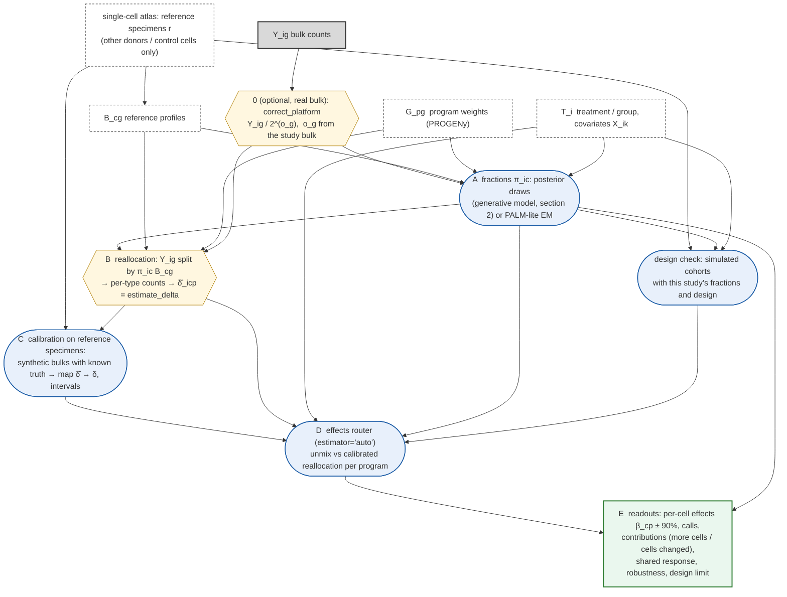
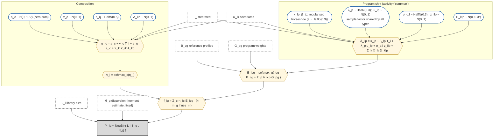

# PALM-bulk as a DAG (method freeze v2, 2026-11-03)

PALM is a pipeline of four stages around one generative model, plus an optional platform correction before it
and readouts after it. This file shows each part as a graph, with the defaults of the frozen method
(`docs/method_spec.md`, "Method freeze v2"). The generative model of stage A is the same one
`bayes/model.py` defines. What changed since the first version of this file (2026-10) is how its outputs are
used. The per-cell-type activity and the treatment effects now come from reallocation, calibration and the
effects router (stages B–D), not from the model's own δ and β.

Indices:
- *i*: sample (N)
- *c*: cell type (C); *l*: lineage (= *c* without groups)
- *p*: program (P)
- *g*: modelled gene
- *k*: covariate (K)
- *r*: reference specimen

## 1. The pipeline

Grey boxes are data. White dashed boxes are fixed inputs. Blue boxes are estimated by a model. Yellow
hexagons are deterministic steps.



## 2. Stage A: the generative model (fractions)

The model below is the one fitted. In the frozen setting it is used for the **fractions** π_ic (50 posterior
draws). Settings: `run_palm_fast(likelihood="nb", activity="common", use_m=False)`, a two-stage fit.
- Stage 1: each sample's likelihood is summarised by a Gaussian at its mode.
- Stage 2: NUTS on the population parameters, with every sample's latents integrated out exactly.

Its δ and β still exist and are reported by `run_palm`. But the frozen effects come from stages B–D, which
are calibrated on data with a known truth.



Plate view:

```
                         ┌─────────────── i = 1..N (samples) ─────────────────────────────┐
 a_c, γ_c, A_kc, s_η ──► │ ε_ic ─► η_ic ─► π_ic ───────────────────┐                      │
                         │                                         ▼                      │
 κ_lp, β_lp, D_klp ────► │ u_ip, z_ilp ─► δ_icp ─► E_icg ───► f_ig = Σ_c π_ic E_icg       │
 λ_p, σ_d,l         ────►│                  ▲                       │                     │
                         │                  │            Y_ig ~ NB(L_i f_ig, θ_g)         │
                         └──────────────────┼───────────────────────▲─────────────────────┘
                     B_cg, G_pg (fixed) ────┘                θ_g (fixed)
```

## 3. Stages B–D: from fractions to calibrated effects

**B. Reallocation** (`core.realloc.reallocate`):
- Each sample's reads are split between cell types in proportion to π_ic B_cg. This is the expectation step
  of BayesPrism / InstaPrism with a fixed reference.
- Each type's share is scored on the model's scale with `estimate_delta`, giving δ̂_icp (per fraction
  draw).
- Reallocation uses the *unshifted* profiles. So a type keeps only part of its own shift (attenuation), and
  part leaks into the other types (leakage).

**C. Calibration** (`core.calibrate`):
- Reference specimens of other donors are thinned 50/50:
  - half 1, summed over types, is a synthetic bulk with known fractions;
  - half 2 gives the true δ.
- Five donor folds; for each, B is built without that fold.
- A ridge map δ ~ 1 + δ̂ per type and program corrects the attenuation.
- Out-of-fold residuals give conformal activity intervals; effect intervals come from pseudo-contrasts
  (`effect_interval="lk"`).

**D. Effects router** (`program_deconvolution(estimator="auto")`, `core.unmix`), per program:
- **Unmix:** δ̂_icp = a_cp + Σ_k A_ickp(γ_kp + T_i β_kp) + e.
  - A is the closed-form leakage operator (how a true shift of type k shows up in type c's reallocated
    activity at sample i's fractions).
  - Type effects are shrunk towards a shared value by REML.
  - Intervals: cluster bootstrap, plus prediction-error variance and the off-program response (misfit).
- **Calibrated reallocation:** the contrast of the calibrated activity. Its interval is widened to the
  simulated absolute leakage error per type, plus this study's noise (`sim_widen="abs"`).
- **Design check:** about 10 synthetic cohorts with this study's fractions and treatment. They are built from
  real reference counts, with planted null / shared / localised effects of the study's size and an
  off-program response.
- **Route (freeze v2):**
  - unmix where its interval is narrower than the calibrated one (mean over types);
  - a type whose unmixed effect falls outside its calibrated interval keeps the calibrated result (the guard);
  - freeze v1 chose by lower simulated RMSE, which flipped between splits for shared responses.
- With covariates or donor pairs, the contrast weights are OLS (paired designs) or IPW / AIPW.

## 4. Stage 0 and stage E

**0. Platform correction** (`correct_platform`, opt-in, for real bulk with a single-cell reference):
- o_g = per-gene log2 offset estimated from the study bulk, alternating PALM-lite fractions with the median
  log ratio. The bulk is then divided by 2^o_g.
- One offset per gene for every sample, so a treatment difference is not absorbed.
- It cannot fix the study's mean composition (not identifiable from the bulk alone).
- It replaces the model's m_g (`use_m`) in the frozen pipeline.

**E. Readouts:**

| Reported quantity | Comes from |
|---|---|
| Cell-type fractions | π_ic (stage A draws) |
| Per-sample per-type activity ± 90% | calibrated δ̂ (stage C) |
| Per-cell treatment effect β_cp ± 90%, call | stage D |
| Contributions: each type's share of the bulk change, split into "more cells" ½(π₁−π₀)(s₀+s₁) and "cells changed" ½(π₀+π₁)(s₁−s₀) | π (stage A) and β (stage D), `palm_bulk.contributions` |
| Shared vs type-specific response, program-level net change | shared-response fit inside stage D (`unmix_kw=dict(shared=True)`) |
| Robustness to unmeasured confounding | effects and intervals, `causal.robustness_value` |
| Design limit: smallest per-type change this design can resolve | π, B, G, n (`scripts/experiments/identifiability.py`) |

## 5. Points worth reviewing

These are places where the pipeline makes a choice that could be changed. None is known to be wrong.

1. **B is plugged in.** Donor-to-donor variation of the baseline is not a model parameter. Calibration
   carries it into the intervals only through the reference folds.
2. **B is the atlas average of a cell type, not a "resting" state.** Every atlas cell with that label goes
   into it, activated ones included. So δ means "program level relative to the reference's average cell of
   that type".
   - Group contrasts (β) are mostly unaffected: the baseline cancels, up to the small dependence of leakage
     and the exp() scale on B.
   - Absolute activity is only interpretable if the reference is a known state. In the benchmarks it was
     control cells only (vehicle / PBS / unstimulated; COMBAT used other people's cells, sick ones included).
     For a cohort, use the healthy donors of the atlas.
   - **Activation-state clusters must be merged into their parent type** (e.g. "IFN-stimulated monocytes"
     into monocytes). Kept as separate types, a cell that switches a program on is counted as *more cells
     of the activated type* (composition) instead of *cells switched on* (activity).
   - Sensitivity check: rebuild B from another donor subset, or without the activated clusters, and confirm
     the effects barely move.
3. **Two estimates of activity.** The model's δ (stage A) and the calibrated reallocation (stage C) are not
   the same estimator. The frozen method reports the latter, because only it is checked against a known
   truth. The model's δ is used only through the fractions.
4. **G is fixed and the same in every cell type.** A program's footprint can differ by lineage.
5. **The leakage operator is a linearisation at δ = 0.** Strong shared responses can leak nonlinearly. The
   misfit term and the guard limit the damage; they don't remove it.
6. **Composition shifts that follow the response.** In the stress test, responder lines grew ×1.6 under
   treatment, and part of their signal moved to a non-responder. The unmixing assumes the leakage is
   explained by the fractions it is given.
7. **Composition noise ε_ic is independent across cell types** (no covariance), and treatment enters
   linearly, with no dose or interactions.
8. **The design check uses about 10 cohorts.** Route choices close to a tie can still differ between
   studies. The v2 rule compares interval widths, which are less noisy than the simulated RMSEs.
9. **Read shares, not cell numbers.** Contributions and the "more cells" part are shares of RNA. A type that
   makes more RNA per cell looks like more cells unless RNA content is modelled.
