# PALM-bulk model as a DAG

This is the model in [`bayes/model.py`](../src/palm_bulk/bayes/model.py) with the defaults of `run_palm`:
`use_m=True`, `dispersion="fixed"` (θ_g estimated once from the bulk, not sampled), `reparam=False`, Fisher
gene selection. With `dispersion="gene"` the dispersion block below is sampled instead. Covariates `X` and lineage `groups` are optional.

Indices: sample *i* (N), cell type *c* (C), lineage *l* (= *c* when there are no groups), program *p* (P),
gene *g* (modelled genes), covariate *k* (K).

## Graph

Grey boxes are data, white boxes are fixed inputs (plugged in, not sampled), rounded nodes are sampled
parameters, and hexagons are deterministic functions.

```mermaid
flowchart TD
  classDef obs fill:#d9d9d9,stroke:#333,stroke-width:2px;
  classDef fixed fill:#fff,stroke:#333,stroke-dasharray:4 3;
  classDef latent fill:#fff,stroke:#1f5fa8,stroke-width:1.5px;
  classDef det fill:#fff7e0,stroke:#b07d00;

  %% ---------------- inputs
  T["T_i<br/>treatment (0/1)"]:::fixed
  X["X_ik<br/>covariates, centred"]:::fixed
  B["B_cg<br/>reference baseline<br/>(donor-aware pseudobulk)"]:::fixed
  G["G_pg<br/>program weights (PROGENy)"]:::fixed
  L["L_i<br/>library size over modelled genes"]:::fixed

  %% ---------------- composition
  subgraph COMP["Composition (per sample i, cell type c)"]
    a(["a_c ~ N(0, 1.5²)"]):::latent
    gam(["γ_c ~ N(0, 1)"]):::latent
    seta(["s_η ~ HalfN(0.5)"]):::latent
    eps(["ε_ic ~ N(0, 1)"]):::latent
    A(["A_kc ~ N(0, 1)"]):::latent
    eta{{"η_ic = a_c + γ_c T_i + s_η ε_ic + Σ_k X_ik A_kc"}}:::det
    pi{{"π_i = softmax_c(η_i)"}}:::det
  end

  %% ---------------- program activity
  subgraph PROG["Program shift (per sample i, lineage l, program p)"]
    kt(["τ_κ ~ HalfC(0.3)<br/>λ_κ,lp ~ HalfC(1)<br/>z_κ,lp ~ N(0,1)"]):::latent
    bt(["τ_β ~ HalfC(0.3)<br/>λ_β,lp ~ HalfC(1)<br/>z_β,lp ~ N(0,1)"]):::latent
    kappa{{"κ_lp  regularised horseshoe<br/>(slab² = 1)"}}:::det
    beta{{"β_lp  regularised horseshoe<br/>(slab² = 1)"}}:::det
    sd(["σ_d ~ HalfN(0.3)"]):::latent
    zr(["z_ilp ~ N(0, 1)"]):::latent
    D(["D_klp ~ N(0, 0.3²)"]):::latent
    delta{{"δ_ilp = κ_lp + β_lp T_i + σ_d z_ilp + Σ_k X_ik D_klp<br/>δ_icp = δ_i,l(c),p"}}:::det
  end

  %% ---------------- forward model
  E{{"E_icg = softmax_g( log B_cg + Σ_p δ_icp G_pg )"}}:::det
  subgraph PLAT["Platform scale (per gene)"]
    zm(["z_m,g ~ N(0, 1)"]):::latent
    m{{"m_g = exp(0.3 z_m,g)"}}:::det
  end
  f{{"f_ig = m_g Σ_c π_ic E_icg / Σ_g' (…)"}}:::det

  %% ---------------- likelihood
  subgraph DISP["Dispersion (per gene; sampled only with dispersion='gene', else fixed θ̂_g)"]
    th0(["θ₀ ~ LogN(log 30, 1)"]):::latent
    sth(["s_θ ~ HalfN(0.5)"]):::latent
    zth(["z_θ,g ~ N(0, 1)"]):::latent
    th{{"θ_g = θ₀ exp(s_θ z_θ,g)"}}:::det
  end
  Y["Y_ig ~ NegBin2( L_i f_ig , θ_g )<br/>observed bulk counts"]:::obs

  a --> eta; gam --> eta; seta --> eta; eps --> eta; A --> eta; T --> eta; X --> eta
  eta --> pi
  kt --> kappa; bt --> beta
  kappa --> delta; beta --> delta; sd --> delta; zr --> delta; D --> delta; T --> delta; X --> delta
  B --> E; G --> E; delta --> E
  pi --> f; E --> f; zm --> m; m --> f
  th0 --> th; sth --> th; zth --> th
  f --> Y; L --> Y; th --> Y
```



## Plate view (text)

```
                       ┌──────────── i = 1..N (samples) ───────────────────────────────┐
 a_c, γ_c, A_kc  ─────►│ ε_ic ─► η_ic ─► π_ic ─────────────────┐                       │
 s_η            ─────►│                                       ▼                       │
                       │                              f_ig = norm_g(m_g Σ_c π_ic E_icg)│
 κ_lp, β_lp, D_klp ──►│ z_ilp ─► δ_ilp ─► E_icg ──────────────┘          │            │
 σ_d            ─────►│                    ▲                              ▼            │
                       │                    │              Y_ig ~ NB(L_i f_ig, θ_g)    │
                       └────────────────────┼──────────────────────────▲──▲────────────┘
                     B_cg, G_pg (fixed) ────┘                 m_g ─────┘  θ_g
```

## What the outputs are, in DAG terms

| Reported quantity | Node(s) |
|---|---|
| Cell-type fractions | π_ic |
| Cell-type program activity | δ_icp (and its mean κ_lp) |
| Treatment effect on activity (intrinsic) | β_lp |
| Treatment effect on composition | γ_c |
| Attribution / intrinsic vs composition split | functions of π, E, δ downstream of the fit (`core.equations`) |

## Points worth reviewing

These are places where the graph makes a choice that could be changed. None is known to be wrong.

1. **B is plugged in.** Reference profiles have no uncertainty, so donor-to-donor variation in the baseline
   is not passed on to π or δ, and intervals may be too narrow. Option: B_cg as a latent node with a
   prior centred on the reference (e.g. log B_cg ~ N(log B̂_cg, s²_c,g) from donor spread).
2. **m_g is shared by all cell types.** Bulk-vs-scRNA bias that differs by cell type has nowhere to go
   except δ. Also, when one cell type dominates, κ_cp G_pg and log m_g move the same genes, so they are
   separated mainly by the priors (σ_m = 0.3 fixed, horseshoe on κ).
3. **G is fixed and the same in every cell type.** A program's footprint can differ by lineage. Option: a
   per-(lineage, program) scale or a small gene-level deviation on G.
4. **One residual σ_d for every lineage and program.** Programs that vary a lot between donors (e.g. NFkB)
   and quiet ones share one scale. Option: σ_d,p or σ_d,lp.
5. **One global τ for κ and one for β, slab fixed at 1.** The slab (largest plausible shift) is not learned
   and is the same for all programs.
6. **Composition noise ε_ic is independent across cell types.** Real compositions have correlated
   fluctuations (e.g. T vs monocyte trade-off). Option: a covariance (LKJ) on ε.
7. **Treatment enters linearly and alone.** No T × X interactions, no dose or multi-level conditions, and
   the covariate effects D are not sparse.
8. **Dispersion θ_g is a plug-in estimate by default** (like B), and does not depend on the mean. Fine for moderate depth; a mean–dispersion trend could
   help low-count genes.
9. **Sampler geometry.** a and γ have a direction the softmax ignores; `reparam=True` removes it, but on
   PBMC it lowered ESS once the dispersion funnel was gone, so it is off. The worst geometry was the
   sampled dispersion hierarchy (s_θ with 1,000 z_θ,g), now replaced by fixed estimates by default.
